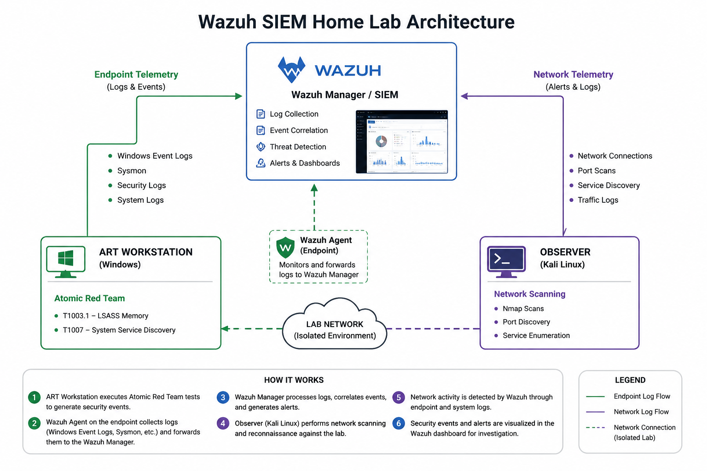

# wazuh-siem-home-lab
A cybersecurity home lab demonstrating SIEM deployment, endpoint monitoring, security event investigation, and attack detection using Wazuh.
# Wazuh SIEM Home Lab

## Overview

This project documents a cybersecurity home lab designed to explore Security Information and Event Management (SIEM), endpoint monitoring, security event detection, and incident investigation using Wazuh.

The lab was developed to gain hands-on experience with defensive cybersecurity operations and to better understand how security events can be detected and investigated from a Blue Team perspective.

## Objectives

- Deploy and configure a Wazuh SIEM environment
- Configure endpoints to forward security logs
- Generate controlled security events
- Investigate alerts generated by simulated attack activity
- Explore the relationship between security events and MITRE ATT&CK techniques
- Develop practical experience with SIEM-based security monitoring

## Lab Architecture

The lab consists of a Wazuh SIEM environment used to collect and analyze security telemetry generated by endpoints and controlled security testing.

### Components

- **Wazuh Manager/SIEM** — Centralized collection and analysis of security events.
- **ART Workstation** — Windows endpoint used to generate controlled security activity with Atomic Red Team.
- **Observer** — Device used to conduct network scanning and reconnaissance within the lab environment.
- **Wazuh Agent** — Collects and forwards endpoint telemetry to the Wazuh Manager.
- **Atomic Red Team** — Used to simulate specific MITRE ATT&CK techniques in a controlled environment.

## Investigations

This section documents the security testing and investigations conducted within the lab environment.

| Investigation | Technique / Activity | Focus |
|---|---|---|
| [T1003.1 — LSASS Memory](investigations/t1003.1-lsass-memory.md) | MITRE ATT&CK T1003.1 | Credential Access |
| [T1007 — System Service Discovery](investigations/t1007-system-service-discovery.md) | MITRE ATT&CK T1007 | Discovery |
| [Nmap Network Reconnaissance](investigations/nmap-network-reconnaissance.md) | Network Reconnaissance | Network Monitoring |

## Experiments

### Experiment 1 — Credential Access

Atomic Red Team test:

`T1003.1 — LSASS Memory`

A controlled Atomic Red Team test was executed against the ART Workstation to generate security telemetry associated with credential access.

The resulting activity was investigated through Wazuh.

### Experiment 2 — System Service Discovery

Atomic Red Team test:

`T1007 — System Service Discovery`

A controlled Atomic Red Team test was executed against the ART Workstation to generate system discovery activity.

The resulting telemetry was examined through Wazuh.

### Experiment 3 — Network Scanning

Network scanning activity was conducted from the Observer device to identify open ports and services on the lab environment.

The resulting network activity was analyzed from a defensive perspective.

## Key Lessons Learned

One of the major challenges encountered during the lab was initially receiving insufficient endpoint telemetry in Wazuh.

Investigation revealed that the required endpoint logging and forwarding configuration had not been properly established. After configuring the endpoint to forward the appropriate logs, the experiment was rerun and the expected security activity became visible within Wazuh.

This highlighted the importance of validating log collection and endpoint telemetry before attempting to investigate security events.

## Skills Demonstrated

- SIEM configuration
- Security event monitoring
- Log analysis
- Endpoint telemetry
- Windows security monitoring
- Atomic Red Team
- MITRE ATT&CK
- Network reconnaissance detection
- Basic incident investigation
- Troubleshooting

## Future Improvements

Future iterations of this lab will explore:

- Additional Atomic Red Team techniques
- Custom Wazuh detection rules
- Expanded Windows event monitoring
- Additional endpoint telemetry
- Incident response workflows
- Detection engineering
