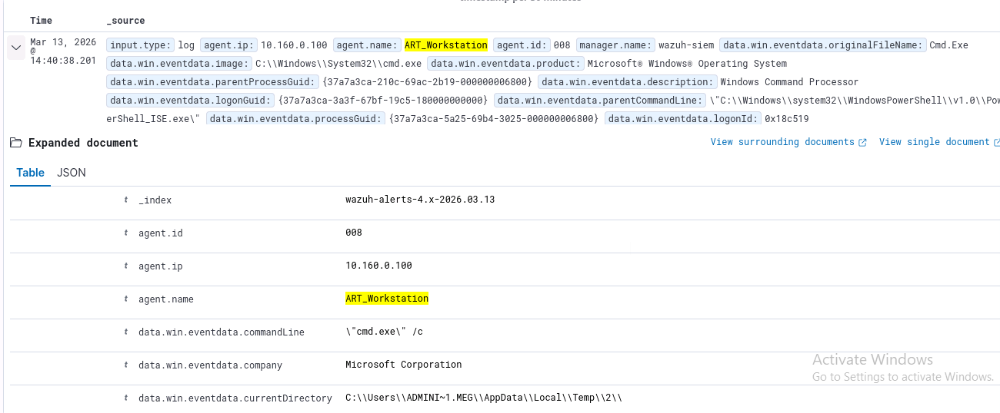
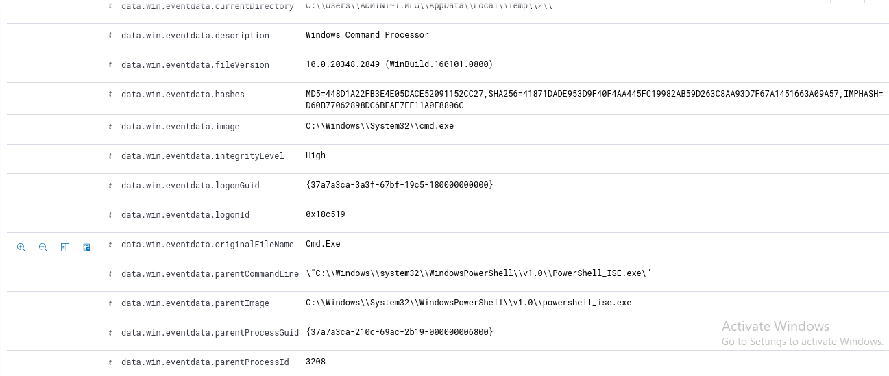

# T1003.1 — LSASS Memory Investigation

## Overview

This investigation documents a controlled execution of MITRE ATT&CK technique **T1003.1 — LSASS Memory** using Atomic Red Team against the ART Workstation. The objective was to generate credential-access activity and evaluate whether the Wazuh SIEM environment could collect and detect the resulting endpoint telemetry.

The experiment also provided an opportunity to troubleshoot the lab's endpoint logging configuration and validate that the required telemetry was being successfully forwarded to Wazuh.

## Objective

The objectives of this experiment were to:

* Execute a controlled Atomic Red Team test for T1003.1.
* Generate security telemetry associated with LSASS memory access.
* Verify that the ART Workstation was properly forwarding telemetry to Wazuh.
* Investigate the resulting Wazuh alert.
* Identify and resolve any issues preventing the SIEM from receiving relevant telemetry.

## Environment

* **SIEM:** Wazuh
* **Endpoint:** ART Workstation
* **Testing Framework:** Atomic Red Team
* **Technique:** T1003.1 — LSASS Memory
* **Endpoint Telemetry:** Windows Event Logs / Sysmon

## Test Procedure

The Atomic Red Team framework was used to identify and execute the appropriate test.

### 1. Review available Atomic Red Team tests

The following command was used to review the available tests:

```powershell
Invoke-AtomicTest all -ShowDetailsBrief
```

### 2. Check prerequisites

The prerequisites for T1003 were checked using:

```powershell
Invoke-AtomicTest T1003 -CheckPrereqs
```

### 3. Execute the test

The T1003.1 test was executed with:

```powershell
Invoke-AtomicTest T1003 -TestNumbers 1 -cleanup
```

### 4. Restore the testing environment

The session was returned to its original state using:

```powershell
Invoke-AtomicTest T1003-1 -cleanup -Session $sess
```

## Initial Results

The initial execution did not produce the expected security telemetry within Wazuh.

This issue was not immediately attributed to the Atomic Red Team test itself. The lab configuration and endpoint telemetry collection were reviewed to determine why the expected activity was not appearing in the SIEM.

## Troubleshooting

Further investigation identified that **Sysmon had not been properly downloaded and configured on the ART Workstation**.

Because the endpoint was not generating and forwarding the necessary telemetry, Wazuh did not have the expected event data available for analysis.

Sysmon was subsequently downloaded and configured on the ART Workstation, after which the experiment was rerun.

Detection

After correcting the endpoint telemetry configuration and rerunning the Atomic Red Team test, Wazuh successfully generated a High-severity security alert.

The alert demonstrated that endpoint telemetry was successfully reaching Wazuh after Sysmon was configured. However, the available alert information does not conclusively establish that the alert represented detection of the T1003.1 — LSASS Memory technique.




Observed Result

The successful generation of a Wazuh alert demonstrated that:

The ART Workstation was generating security telemetry.
The endpoint was successfully forwarding telemetry to the Wazuh environment.
Wazuh was processing the resulting telemetry and generating an alert.
Additional analysis would be required to determine whether the alert specifically detected the T1003.1 activity.

## MITRE ATT&CK Mapping

**T1003.1 — LSASS Memory** 

**Tactic:** Credential Access

T1003.1 involves accessing the memory of the Local Security Authority Subsystem Service (LSASS), which may contain authentication material. Attackers can attempt to access this information to obtain credentials and facilitate further compromise.

The Atomic Red Team test provided a controlled method for generating activity associated with this technique within the lab environment.

## Lessons Learned

The primary lesson from this experiment was the importance of validating security telemetry and configuration before conducting an investigation.

The initial failure to generate Wazuh data demonstrated that having a SIEM deployed does not necessarily mean that useful endpoint telemetry is being collected. Proper configuration of endpoint logging and forwarding is essential for effective detection and investigation.

This experience reinforced the importance of **checking configuration details and validating telemetry before running security experiments or deploying similar monitoring environments in a live production setting**.

## Key Takeaways

*Controlled attack simulations can be used to validate whether security telemetry is reaching a SIEM.
*A generated SIEM alert does not necessarily mean the intended attack technique was specifically detected.
*Detection validation requires examining the alert details, underlying event data, and detection rule.
